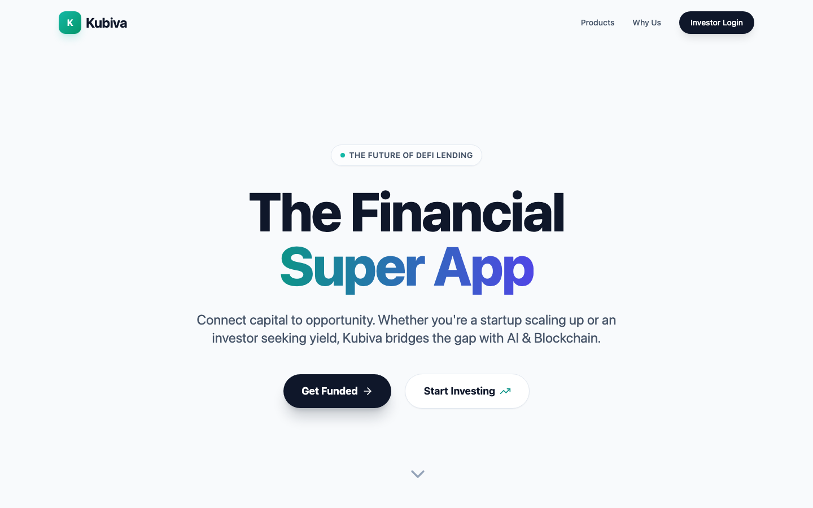
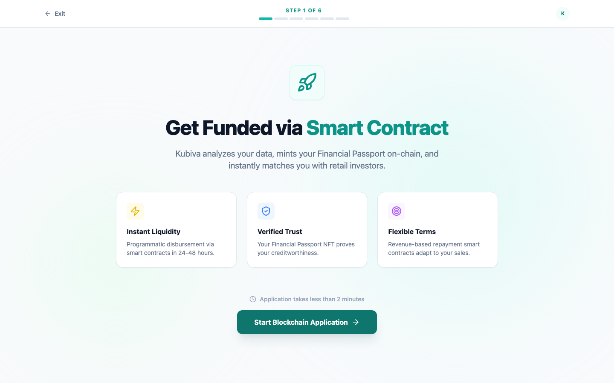
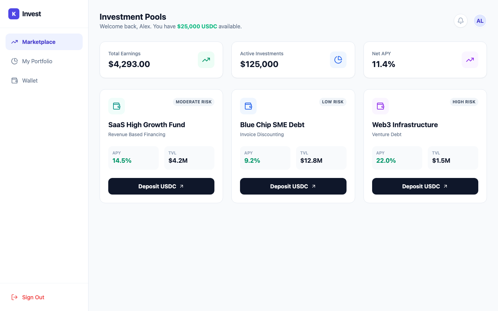

# Kubiva: The Financial Super App

> Connect capital to opportunity. Kubiva gives startups, businesses and individuals fast, data-driven access to financing, and gives investors a way to fund them with on-chain, DeFi-style lending pools.

Kubiva is a working prototype of a lending marketplace. A borrower walks through a guided flow, an AI-style engine assesses their financial health in seconds, and the platform returns personalised financing products, backed by a **Financial Passport NFT** and settled through **smart contracts**. Investors deposit USDC into risk-rated pools.



<table>
  <tr>
    <td><br/><sub><b>Startup funding flow:</b> apply in under 2 minutes</sub></td>
    <td><br/><sub><b>Investor marketplace:</b> risk-rated USDC pools</sub></td>
  </tr>
</table>

## The problem

Early-stage founders and small businesses are often rejected by traditional lenders. Banks want collateral and years of history, and decisions take weeks. Investors, meanwhile, have no simple way to back this borrower segment.

## What Kubiva does

| Persona | Flow |
|---|---|
| **Startups** | Guided multi-step journey: company basics, financials, connect data, AI risk analysis, benchmarking, product comparison, finalised offer |
| **Businesses** | Business loan application flow |
| **Individuals** | Individual loan application flow |
| **Investors** | Marketplace of risk-rated pools (Revenue-Based Financing, Invoice Discounting, Venture Debt) showing APY and TVL, with USDC deposits |

### Startup journey highlights

- **Risk scoring.** The backend produces a 0 to 100 risk score and category (Very Low to Critical), with the strengths and risk factors behind it.
- **Debt capacity.** It estimates annual revenue, operating profit, DSCR, a safe borrowing limit and the maximum affordable monthly EMI.
- **Industry benchmarks.** Revenue, burn rate and gross margin are compared against industry peers.
- **Tailored products.** It recommends Fixed EMI loans, **Revenue-Based Financing** (pay a % of revenue, no fixed EMI), Seasonal Flex EMI and more, priced by risk.
- **Financial Passport.** Creditworthiness is minted as an on-chain NFT that investors can verify.
- **Instant application.** It returns an application ID, approved amount, first payment date and a next-steps timeline.

## Tech stack

- **Frontend:** React 19, Vite, React Router, Tailwind CSS, Framer Motion, Lucide icons
- **Backend:** Python, FastAPI, Pydantic, Uvicorn

## Architecture

```
frontend/ (React + Vite)  ──HTTP/JSON──▶  backend/ (FastAPI)
  Landing page                              POST /api/startups/analyze-documents
  Startup / Business / Individual flows     POST /api/startups/create-application
  Investor dashboard                        GET  /            (health check)
```

## Run it locally

**Backend**

```bash
cd backend
pip install -r requirements.txt
uvicorn main:app --reload --port 8000
```

API docs are served at http://localhost:8000/docs.

**Frontend**

```bash
cd frontend
npm install
npm run dev
```

Open http://localhost:5173.

## Project status and roadmap

This is a prototype. The scoring engine and loan products use **mock logic** to demonstrate the product experience end to end. Next steps:

- [ ] Replace mock scoring with real bank and accounting data (account-aggregator / Plaid-style integrations)
- [ ] ML-based underwriting trained on cash-flow data
- [ ] Real KYC and disbursal
- [ ] Investor-side matching and on-chain settlement
- [ ] Authentication and persistent storage

## Why this matters

Underwriting based on live cash flow, rather than collateral, can open credit to the many viable businesses that banks currently overlook.
